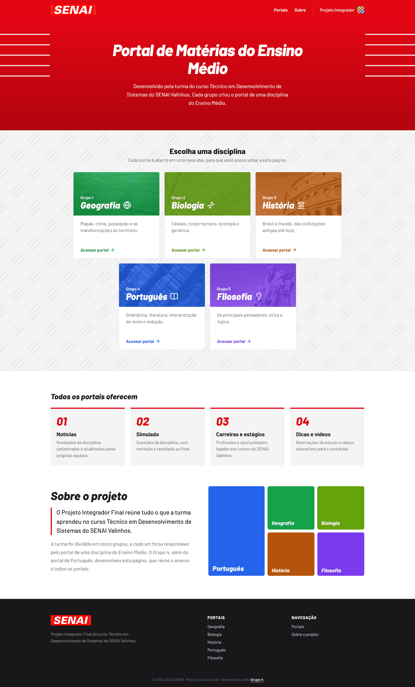
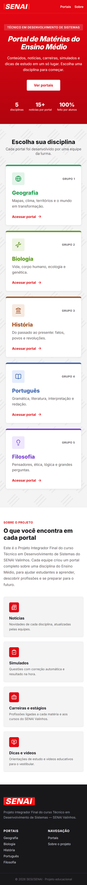

# Portal Integrador | SENAI

Página inicial (lobby) que reúne e dá acesso aos cinco portais educacionais do **Projeto Integrador Final** do curso Técnico em Desenvolvimento de Sistemas do SENAI Valinhos.

**Site publicado:** https://portal-integrador-senai.vercel.app



## Sobre o projeto

Cada equipe da turma desenvolveu um portal completo sobre uma disciplina do Ensino Médio. O Portal Integrador é a porta de entrada desses portais: apresenta o projeto e direciona o visitante para a disciplina escolhida.

| Grupo | Disciplina |
| ----- | ---------- |
| 1     | Geografia  |
| 2     | Biologia   |
| 3     | História   |
| 4     | Português  |
| 5     | Filosofia  |

Este repositório foi desenvolvido pelo **Grupo 4**, responsável pela missão extra do Portal Integrador.

Conforme o enunciado da atividade, o Portal Integrador **não utiliza** banco de dados, autenticação, painel administrativo ou CRUD. Sua função é exclusivamente reunir e direcionar os visitantes aos cinco portais.

## Funcionalidades

- Página inicial com a identidade visual do SESI/SENAI.
- Cards de acesso aos cinco portais, cada um com a cor, o ícone e uma foto da disciplina.
- Os portais abrem em uma nova aba, mantendo o lobby aberto.
- Seção com o que todos os portais oferecem e seção "Sobre o projeto".
- Layout responsivo para computadores, tablets e celulares.
- Favicon e imagem de prévia para compartilhamento do link (Open Graph).

### Versão para celular



### Prévia do link ao compartilhar


## Tecnologias

| Tecnologia     | Uso                                      |
| -------------- | ---------------------------------------- |
| Next.js 16     | Framework principal (App Router, `src/`) |
| React 19       | Componentes da interface                 |
| JavaScript     | Linguagem (sem TypeScript)               |
| CSS Modules    | Estilização por componente               |
| Barlow         | Fonte (Google Fonts, via `next/font`)    |
| lucide-react   | Ícones                                   |
| ESLint         | Padronização do código                   |
| Git e GitHub   | Versionamento                            |
| Vercel         | Publicação                               |

## Pré-requisitos

- [Node.js](https://nodejs.org) 20.9 ou superior
- npm (instalado junto com o Node.js)
- Git

## Instalação e execução

1. Clone o repositório:

   ```bash
   git clone https://github.com/ferrnd/portal-integrador-senai.git
   cd portal-integrador-senai
   ```

2. Instale as dependências:

   ```bash
   npm install
   ```

3. Rode em modo de desenvolvimento:

   ```bash
   npm run dev
   ```

4. Acesse http://localhost:3000 no navegador.

### Outros comandos

| Comando         | O que faz                                   |
| --------------- | ------------------------------------------- |
| `npm run build` | Gera a versão de produção                   |
| `npm start`     | Roda a versão de produção (após o `build`)  |
| `npm run lint`  | Verifica o código com o ESLint              |

## Configuração

O projeto **não precisa de variáveis de ambiente** (`.env`).

Os links dos portais ficam em `src/data/portais.js`. Para atualizar o endereço de um portal, altere o campo `href` da disciplina:

```js
{
  grupo: 4,
  materia: "Português",
  descricao: "Gramática, literatura, interpretação de texto e redação.",
  Icon: BookOpen,
  cor: "#2563eb",
  foto: "/fotos/portugues.webp",
  href: "https://endereco-do-portal.vercel.app",
},
```

## Estrutura de pastas

```
src/
├── app/
│   ├── favicon.ico            # Ícone da aba
│   ├── globals.css            # Cores, reset e textura de fundo
│   ├── layout.js              # Layout raiz, fonte e metadados
│   ├── opengraph-image.png    # Imagem de prévia do link
│   └── page.jsx               # Página inicial
├── components/
│   ├── Header.jsx             # Cabeçalho com logo e navegação
│   ├── Hero.jsx               # Seção principal
│   ├── Portais.jsx            # Grade com os cinco portais
│   ├── PortalCard.jsx         # Card de acesso a um portal
│   ├── Sobre.jsx              # Recursos dos portais e seção sobre o projeto
│   └── Footer.jsx             # Rodapé
│   (cada componente tem seu próprio arquivo .module.css)
└── data/
    └── portais.js             # Dados dos portais e dos recursos
public/
├── fotos/                     # Fotos dos cards (uma por disciplina)
├── marca-integrador.png       # Marca listrada usada no cabeçalho
├── mosaico-disciplinas.webp   # Imagem das disciplinas na seção Sobre
└── senai-logo.webp            # Logo do SENAI
docs/                          # Capturas de tela usadas neste README
```

## Publicação

O projeto está conectado à Vercel. Cada `push` na branch `main` gera uma nova publicação automaticamente.

## Imagens

As fotos dos cards são do [Unsplash](https://unsplash.com) e do [Pexels](https://www.pexels.com), de uso livre e sem exigência de crédito. Elas foram convertidas para preto e branco e recebem a cor de cada disciplina por cima. Nenhuma imagem mostra pessoas.

## Privacidade

Seguindo a LGPD e as regras da atividade, o site não coleta dados pessoais, não possui formulários e não exibe fotos ou informações pessoais de alunos, professores ou terceiros.

---

Projeto Integrador Final · Técnico em Desenvolvimento de Sistemas · SENAI Valinhos
